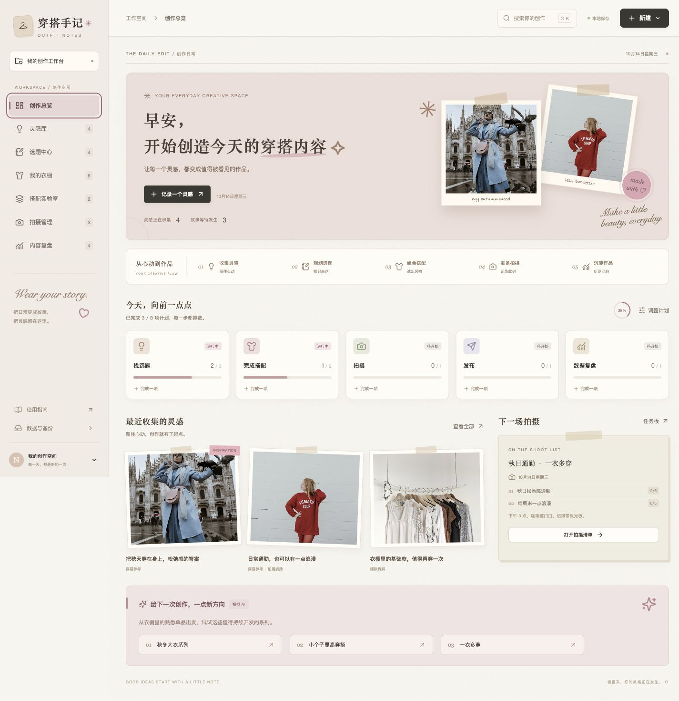

# 穿搭手记 · Outfit Notes

给穿搭博主的内容生产工作台。React + TypeScript + Tailwind CSS + Vite，数据保存在 localStorage。设计采用米白、雾粉、纸张纹理、胶带照片与手账卡片，参考用户提供的拼贴网页。

## 在线使用

**[打开穿搭手记](https://zhanyina1205-ai.github.io/outfit-notes/)** · [GitHub 仓库](https://github.com/zhanyina1205-ai/outfit-notes)

无需安装或登录，电脑和手机浏览器均可使用。首次打开包含示例内容，左侧「数据与备份」支持导出记录、恢复备份和清空示例。

每个人的数据只保存在自己的浏览器中，不能跨设备同步。请定期导出备份；本地开发地址和在线地址的数据互相独立，要迁移时先导出，再在新地址导入。



## 下载与本地运行

建议 Node.js 22.12+，本次验证使用 Node.js 24。

```sh
git clone https://github.com/zhanyina1205-ai/outfit-notes.git
cd outfit-notes
npm ci
npm run dev
```

打开 http://127.0.0.1:5173 。开发服务器使用固定端口；若已运行，直接打开这个地址。

```sh
npm test           # 数据保存、备份校验、关系清理等单元测试
npm run build      # 严格 TypeScript 检查 + 生产构建
npm run preview    # 预览 dist，默认 http://127.0.0.1:4173
```

## MVP 功能

| 页面 | 已实现的行为 |
| --- | --- |
| 创作总览 | 五类今日任务、状态与进度、今日计划编辑、最近灵感、下一场拍摄、模拟选题方向 |
| 灵感库 | 图片上传/链接、标题、来源、标签、备注，搜索筛选、增删改、模拟分析、转为选题 |
| 选题中心 | 分类筛选、四列状态看板、增删改、状态切换、单品+风格生成10个选题、勾选批量保存 |
| 我的衣橱 | 单品图片、品牌、颜色、风格、购买时间、分类、增删改、使用统计、关联内容、模拟建议 |
| 搭配实验室 | 手动搭配/模拟生成，选择上衣、裤子或裙子、鞋、包，保存风格、场景、镜头建议，加入拍摄计划 |
| 拍摄管理 | 主题、日期、选题、Look 关联、备注、三列状态看板，每套5项清单，完成后录入发布数据 |
| 内容复盘 | 手动录入发布指标、增删改、四项总指标、热门排行切换、收藏率、模拟复盘 |

提供全局搜索（⌘/Ctrl K）、空状态、图片失效占位、手机导航、表单校验、弹窗键盘操作、保存反馈、删除确认、JSON 备份与恢复。

视觉包含复古纸张、柔粉卡片、胶带照片和创作路线；滚动入场、数字过渡、悬停和弹窗动效支持系统的「减少动态效果」偏好。

## 自动发布与 Fork

主分支 `main` 每次推送后，GitHub Actions 自动安装依赖、运行测试、构建并部署到 GitHub Pages。Pull Request 仅运行检查，不部署。

如果 Fork 到自己的账号，在仓库 Settings → Pages 中选择 **GitHub Actions**，启用 Actions 后运行工作流。构建路径自动采用当前仓库名。访问 `https://你的账号.github.io/你的仓库名/`。

部署采用 [Vite 的 GitHub Pages 配置](https://vite.dev/guide/static-deploy.html#github-pages)。当前为静态应用，真实 AI 接口需另外部署服务端。

## 工作流程

1. 在灵感库记录参考图，点击模拟分析，再转为选题。
2. 添加衣橱单品；在搭配实验室组合成 Look。
3. 从选题卡或搭配卡安排拍摄，关联对应的选题与搭配。
4. 逐套勾选5项拍摄清单。全部勾选后才能设置「完成」。取消完成任务的勾选会将拍摄移回「拍摄中」。
5. 从完成拍摄卡录入发布数据，关联选题会自动设为「已发布」，衣橱发布计数随关联自动统计。
6. 查看收藏/播放排行，生成模拟复盘，为下一轮选题提供线索。

首页任务是个人每日计划，数量与完成进度由用户手动设置；新增实体不会自动替你判断是否完成了今日计划。

## 文件结构

```text
outfit-workbench/
├── public/
│   ├── favicon.svg
│   └── images/                  # 本地示例穿搭图片
├── src/
│   ├── main.tsx                 # 应用入口
│   ├── App.tsx                  # 导航、全局搜索、备份与弹窗
│   ├── types.ts                 # 实体类型与 Zod 校验契约
│   ├── styles.css               # Tailwind + 手账设计系统 + 响应式布局
│   ├── polish.css               # 视觉优化与动效
│   ├── components/
│   │   ├── ui.tsx               # 按钮、卡片元素、弹窗、Toast
│   │   ├── motion.tsx           # 滚动入场与数字过渡
│   │   ├── ImageField.tsx       # 图片上传与本地压缩
│   │   └── EntityEditor.tsx     # 六类实体的新增/编辑表单
│   ├── pages/                   # 七个独立页面和通用筛选
│   ├── data/seed.ts             # 可体验全流程的示例数据
│   ├── lib/date.ts              # 北京时间日期与数字格式化
│   └── services/
│       ├── repository.ts        # 存储接口、备份校验、关系清理、统计
│       ├── workspace.tsx        # React 数据状态、保存与错误处理
│       ├── workspace-context.ts # 页面使用的数据访问接口
│       └── ai.ts                # AIProvider 接口与模拟实现
├── docs/AI-INTEGRATION.md        # 真实 AI 和数据库接入方案
├── .github/workflows/deploy.yml  # 检查和 GitHub Pages 自动发布
├── tests/repository.test.ts
├── index.html
├── package.json
├── package-lock.json
├── tsconfig.json
└── vite.config.ts
```

## 数据与当前边界

- 首次打开展示示例数据。进入「数据与备份 → 清空工作台」可开始自己的创作，执行前有确认步骤。
- 所有数据只保存在当前浏览器的当前地址，不跨设备或多人同步；清理网站数据会丢失记录。`localhost` 与 `127.0.0.1` 的数据也独立。
- 上传支持 JPG、PNG、WebP，源文件上限15 MB，自动压缩到最长边1000 px；每张压缩后约450 KB以内。浏览器 localStorage 总空间有限，保存失败会提示且保留原状态；可用图片链接降低占用。
- 备份包含图片与记录。恢复前校验版本、实体字段、日期、唯一 ID、关联完整性和拍摄状态；恢复会覆盖当前数据，请先导出当前备份。
- 删除记录会清理相关引用，其他记录继续保留。衣橱统计基于当前搭配与发布关联，编辑搭配也会改变统计；历史不可变快照可在下一版引入。
- 所有 AI 均为带短暂加载状态的模拟结果，无真实模型调用；播放、点赞等指标为手动录入，没有自动连接内容平台。
- 示例服饰照片用于演示界面，并非商品实拍或购买推荐。

## 下一步

真实 AI、图片存储和数据库接入见 [接入说明](docs/AI-INTEGRATION.md)。替换 services 层即可逐步扩展，页面不必整体重写。

## 示例图片来源

示例资源已保存在 `public/images`，运行时不依赖外部图片服务：

- [街头风格照片](https://images.unsplash.com/photo-1539109136881-3be0616acf4b)（图片标识 photo-1539109136881-3be0616acf4b）
- 原始图片来源为 `images.unsplash.com`，其余图片标识：photo-1485230895905-ec40ba36b9bc、photo-1483985988355-763728e1935b、photo-1490481651871-ab68de25d43d、photo-1441986300917-64674bd600d8、photo-1434389677669-e08b4cac3105。
